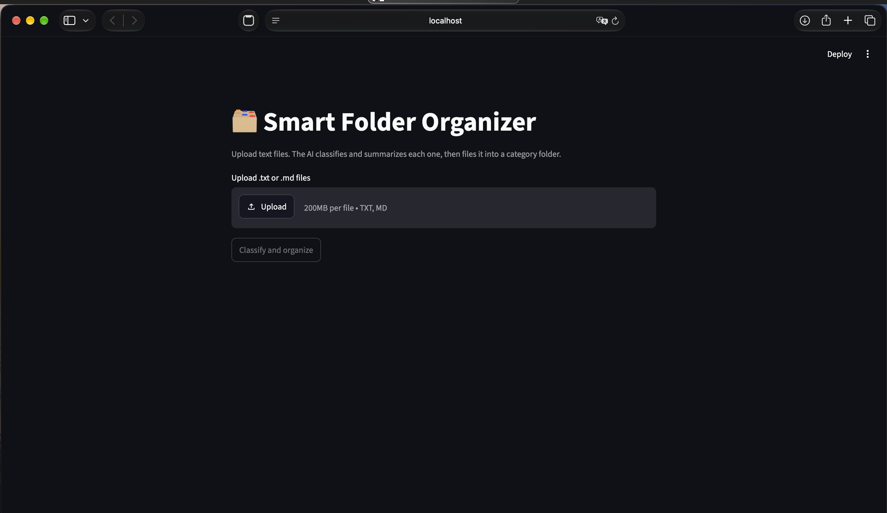
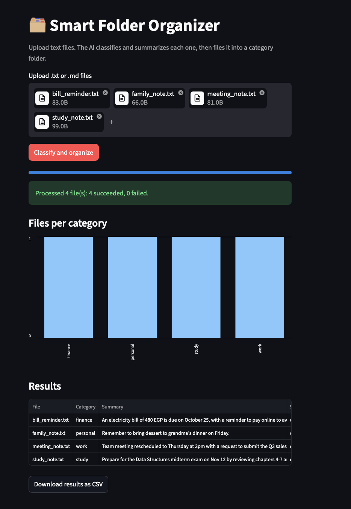

# AI Automation Tool: Smart Folder Organizer

A Python tool that reads text files from an inbox folder, uses the Cohere API
to classify and summarize each one, moves it into a category folder, and
records everything in a CSV log.

<p align="center">
  
  
</p>

## How it works
1. Reads `.txt` and `.md` files from `inbox/`
2. Sends each file's text to the AI and asks for a category and a one-line summary
3. Validates the AI's reply (falls back to "other" if it is malformed)
4. Moves the file to `organized/<category>/` and appends a row to `log.csv`

## Features
- Structured AI output with safe JSON parsing and category validation
- Automatic category folders (work, study, finance, personal, other)
- Never overwrites files: duplicates get a numbered name
- Errors on one file are logged and do not stop the run
- Unit tests for the parser and the file organizer

## Tech stack
Python, Cohere API, python-dotenv, pytest

## Setup
```bash
git clone https://github.com/YOUR_USERNAME/AI_Automation_Tool.git
cd AI_Automation_Tool
python3 -m venv venv
source venv/bin/activate
python -m pip install -r requirements.txt
cp .env.example .env   # then add your Cohere API key
```

## Run
```bash
cp samples/*.txt inbox/    # try the sample files
python src/main.py
python -m pytest           # run the tests
```

## Project structure
- `reader.py`: finds and reads inbox files
- `classifier.py`: builds the prompt and parses the AI reply
- `organizer.py`: moves files and writes the log
- `main.py`: runs the whole pipeline
- `api_client.py`: the only file that talks to the AI provider

## Future improvements
- Support PDF files
- Watch the inbox folder and process new files automatically
- Add Hugging Face as an alternative provider